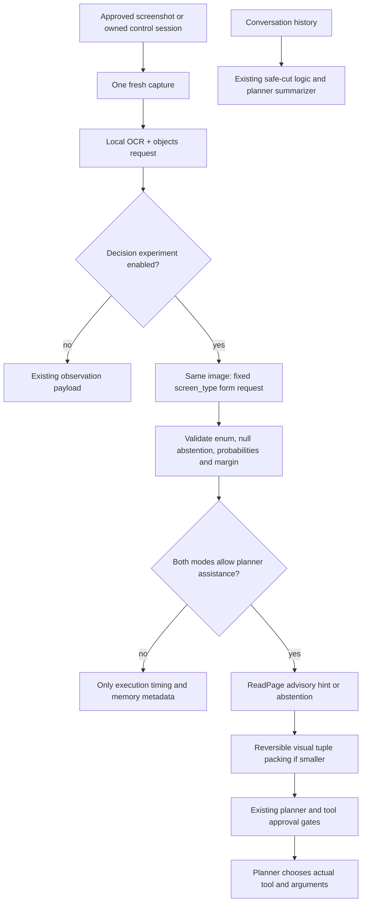

# Image decision experiment: read-tool hints and visual-record compaction

This is a separate opt-in experiment on top of approved screenshot perception. Mirage's form API consumes an **image and a form definition**. It is not a general classifier over the user's request or chat transcript. It cannot decide which tool fulfills a user's intent from a screenshot alone, and this integration does not use it to write tool arguments, summarize messages, or choose conversation turns to discard.

## Verified API

The same pinned Cactus WASM runtime exposes `cactus_describe` with a `form` option. The Python `Mirage.extract(image, form)` wrapper calls that path. The fixed question is:

```json
{"form":{"screen_type":{"enum":["dialog","form","document","other"]}}}
```

The real model returns `result.form.screen_type.value` and a `probabilities` map. It can return **null**, with an additional `"-"` probability representing abstention. This is a normal outcome, not a malformed response. Enum likelihoods are relative to the supplied choices and preceding form fields; they are not calibrated probabilities that a tool is safe or that an action succeeded.

The [upstream architecture description](https://cactuscompute.com/blog/structured-perception) explicitly separates semantic decoding from OCR: recognized strings are not fed into the semantic decoder, and form mode does not run the OCR reader. Consequently, the worker makes a second image inference request after the existing OCR/object request, reusing the loaded model and the same approved image. It does not take another screenshot. It receives no conversation history, tool descriptions, user instructions, or network prompt.

## What the implementation does

**Routing:** after validating all probabilities, a selected `document` class with probability >=0.8 and margin >=0.2 produces a `ReadPage`/`text` hint; `dialog` or `form` produces a `ReadPage`/`elements` hint. The competing abstention probability participates in the margin. Invalid outputs, null, `other`, low scores and small margins abstain. These thresholds are conservative heuristics, not a calibration result.

The hint is a fixed application mapping to a read-only observation tool. It does not call or activate a tool, generate a selector/index/URL, supply action arguments, modify tool policies, or replace `ToolSearch`/`GetTool`. The existing planner decides whether the hint makes sense for the user's actual request, provides the real call arguments/reason, and passes the unchanged approval gate. No classifier outcome can authorize `ControlPage`, navigation, submission, or a committing action.

**Compaction:** an accepted visual class permits a reversible tuple encoding of the **current normalized visual observation payload only**. Every retained OCR string, object name, score and bounding box survives. Missing boxes are encoded as null. The schema accompanies the payload, and packing applies only if the encoded observation payload uses fewer UTF-8 JSON bytes than the original. Invalid or uncertain predictions leave the representation unchanged.

This is structured serialization, not semantic summarization. It does not run or modify `planCompaction`, `applyCompaction`, `summarizeSpan`, conversation retention, token-limit triggers, tool-call/result pairing, or the rule that chat compaction is skipped during page control. Saved screenshots, queued image delivery and exact-text verification are unchanged. A compact representation can still be harder for a planner to interpret; task-quality impact has not been measured. Decision/diagnostic metadata can outweigh the observation bytes saved, so the evaluation reports the full envelope as well as payload bytes. Byte counts are not model-specific token counts.

## Architecture



There is intentionally no path from Mirage to the conversation-history compactor. A text-capable decision model or the existing planner would be required to experiment with semantic conversation routing/compaction; that is outside Mirage's verified image interface.

## Settings and privacy

In **Settings → General → Local visual perception**, choose a mode for perception, then the separate **Visual decision experiment** selector. Both settings default to off. The decision selector has off, local-only evaluation, and assistance options.

- Perception off means no classifier inference, regardless of the decision setting.
- Either setting in local-only mode prevents class labels, probabilities, hints and packing decisions from being shared with the planner. Only timing/memory metadata may be returned for the classifier; existing perception/image delivery follows its own mode.
- Only perception-assist **and** decision-assist permit decision content and reversible packing in tool results. These results can reach the selected remote provider and normal transcript/observability storage, like existing approved visual observations.
- Both settings are checked between and after requests. Changing either setting cancels the worker and prevents late result delivery. A classifier failure preserves the original approved observations if consent is unchanged.

There are no extra page reads, captures, external model calls, background classification jobs, raw error disclosures, or changes to action authorization. The fixed question makes page-supplied text data rather than an executable request, but image classifications remain fallible and must not be trusted as instructions.

## Evidence and limits

See [decision benchmark](benchmarks/mirage-decisions.md) for real model outputs, label-order sensitivity, latency, abstention and full-envelope byte measurements. The historical [perception benchmark](benchmarks/mirage.md) is a different experiment; it does not establish decision accuracy. Browser execution and real planner/task outcomes remain separate validation requirements. A fresh Chromium launch for this follow-up again failed on its singleton socket syscall; that environment failure is not a model result.

The [updated license provenance](mirage-license-provenance.md) verifies that the newly Apache-2.0-labeled model revision carries the same weight SHA-256 as the initial experiment. The preparer now pins that licensed revision and includes model/runtime notices; generated assets remain outside Git.
