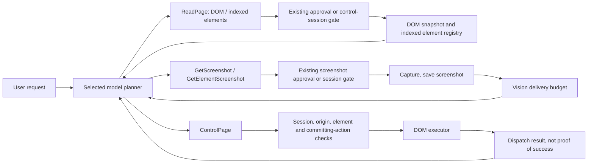
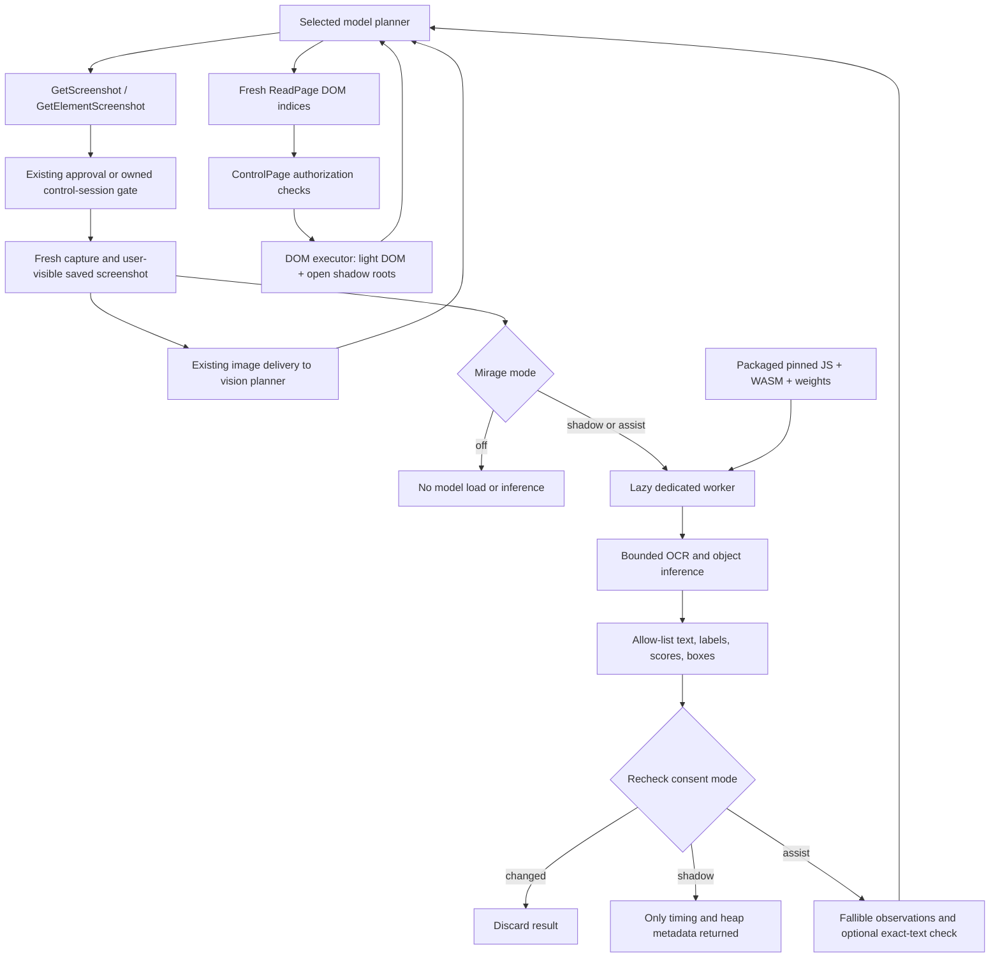

# Mirage local visual perception (experimental)

Lychee can optionally process **already approved screenshots** with Mirage in a dedicated local worker. It returns bounded OCR and object observations for a text or vision planner. It does not choose actions, bypass permissions, or infer that a transaction succeeded. Default installations stay off and do not download/load model assets.

## Original implementation



Before this change the executor could find only light-DOM element stamps, even though ReadPage indexed open shadow roots. The change also clears old stamps throughout open roots before re-indexing and at session cleanup, preventing a stale hidden control from retaining a reassigned index. A successful synthetic click reports dispatch; the model must re-observe to learn its effect. A text-only planner could not read screenshot pixels.

## Where Mirage fits



The worker lives with the side panel, which already owns the screenshot tools; no new offscreen document competes with the background research host. Mirage has no Chrome tab permissions, action tools, or network endpoint. A loaded model is reused, concurrent work is bounded, and timeouts/idle teardown release the worker. Executable assets are packaged, never downloaded at inference time.

## Use

Prepare the optional pinned assets with `npm run prepare:mirage`, then `npm run build`. The model and runtime Apache-2.0 evidence is recorded in [license provenance](mirage-license-provenance.md). The preparation script performs downloads at build time; ordinary builds perform none. Load the unpacked extension and choose **Settings → General → Local visual perception**:

- **Off:** no inference. This is also the fallback for absent or invalid settings.
- **Evaluate locally only:** inference runs but OCR and object content is not returned to the planner. Timing and WASM heap metadata can be inspected in the tool result. Existing screenshot image delivery is unchanged; this is not a global privacy mode.
- **Share observations with the planner:** bounded OCR/object output becomes part of screenshot tool results. It may therefore reach a remote model provider and normal conversation persistence/observability. This consent is separate from permission to capture the page.

After an authorized action, the planner can call:

```json
{"reason":"Check whether the confirmation is visible","expectedText":"Changes saved"}
```

on `GetScreenshot`. `text-observed` means a complete OCR line matched after whitespace/case normalization. `inconclusive` means no matching retained OCR line was found. **Neither status confirms action success**: text may predate the action, OCR may hallucinate, or a match may appear in unrelated content. The system never automatically retries actions. Use fresh DOM evidence and domain-specific confirmation for consequential results.

Full-page screenshots may be too large for the bounded inference input or lose detail on resize. Prefer viewport/element crops. Boxes use Mirage's 0–1000 image coordinate system, not DOM indices, and must never be used directly as click targets. This first version does not join boxes to DOM elements, produce segmentation masks, or automate system/OS control. The planner remains responsible for requesting the next observation.

## Trust and lifecycle

Only screenshot calls which already passed the original gate can invoke perception. Denial/background-tab errors return before capture/inference. The setting is re-read after inference, so switching modes discards an in-flight result. Runtime failures return a generic unavailable status and preserve the saved screenshot. Missing assets do not silently trigger a download.

OCR/object labels are untrusted page-derived data. The adapter limits count, label length, numeric score range and box coordinates; generated reasoning is dropped. The separate [decision experiment](mirage-decisions.md) uses a fixed form and validates its output before producing advisory read-tool hints. The 0.5 detection-score filter is a heuristic, not calibrated OCR correctness. No raw model exception is sent to the planner.

## Runtime and licensing

Verified upstream references (2026-11-15):

- [Mirage overview and coordinate/API contract](https://cactuscompute.com/blog/mirage)
- [Python binding source](https://github.com/cactus-compute/cactus/blob/925b716cb0d823666a92ed71d64eb9c1f4596d68/cactus/agent/mirage.py)
- [Pinned runtime release](https://huggingface.co/Cactus-Compute/cactus/tree/d2c5cd70432ed78345f3ba6b620bff2feeec6c86/releases/4.1.1/wasm)
- [Pinned Mirage weights](https://huggingface.co/Cactus-Compute/mirage/tree/3d03cee88c0acbe4e71b94b567ab14e6e55f40c9)
- [Cactus source/runtime Apache-2.0 license statement](https://github.com/cactus-compute/cactus#license)

The optional preparer pins revisions and verifies SHA-256. Runtime license notices are included in the generated bundle. The initial pinned weights repository lacked license metadata; a subsequently verified Apache-2.0 model-card revision has identical weight bytes. The preparer now pins that licensed revision and packages the notices; see [provenance](mirage-license-provenance.md). No vendor binaries or model weights are committed by this PR. The advertised ~22 MB is compressed weights, **not** browser memory or total extension size.

## Validation and results

See [benchmark report](benchmarks/README.md) for commands, actual measured scope and outstanding browser validation. Vendor phone/NPU performance is not used as a Lychee measurement.

## Optional decision experiment

[Image-only read-tool hints and reversible visual-record compaction](mirage-decisions.md) are separately opt-in. This does not classify chat intent or replace conversation summaries.
